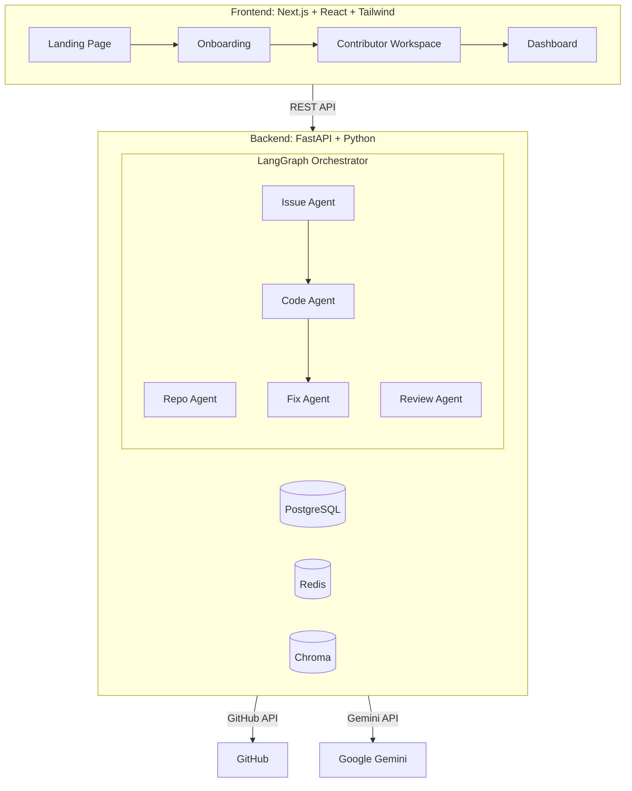
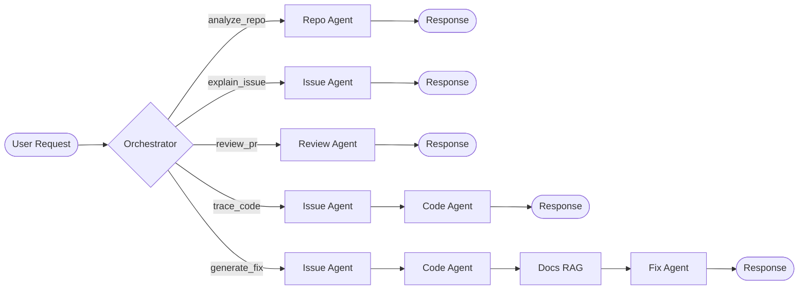
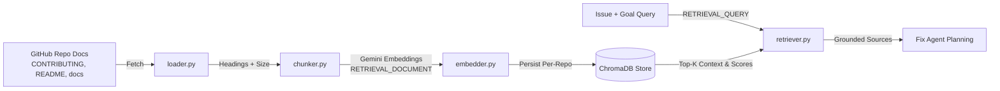

<p align="center">
  
</p>

<h1 align="center">Open Source Mentee Agent</h1>

<p align="center">
  <strong>A multi-agent AI platform that turns overwhelmed newcomers into confident open-source contributors.</strong><br/>
  <em>Built with LangGraph · Google Gemini · FastAPI · Next.js</em>
</p>

---

## 🔥 The Problem

Every year, events like **GSoC** and **Hacktoberfest** attract thousands of eager developers — but the entry barrier is brutal. New contributors face:

- **Codebase overwhelm** — Large repos with zero onboarding docs
- **Opaque issues** — Written for maintainers, not newcomers
- **File-level guesswork** — No idea which files to touch or how they connect
- **PR rejection** — Avoidable bugs, style violations, missing tests

> Over **60% of first-time contributors never submit a second PR.** We're fixing that with AI.

---

## 💡 Our Solution

**Open Source Mentee Agent** deploys **6 specialized AI agents** orchestrated by **LangGraph** to guide contributors through every phase:

```
1. ORIENT     →  Paste a repo URL     →  Instant tech stack & directory breakdown
2. UNDERSTAND →  Paste an issue URL   →  Plain-English summary + difficulty rating
3. DISCOVER   →  AI traces the code   →  Exact files to modify + call graph
4. PLAN       →  AI generates a fix   →  Step-by-step plan with code snippets
5. REVIEW     →  Paste a PR link      →  Catch bugs, security issues & style violations
```

No GitHub OAuth required — enter your username and get a **personalized, gamified dashboard** powered by your real GitHub data.

---

## 🤖 Why Agents? — Innovation

This is **not** a wrapper around a single LLM prompt. Agents are the **core architecture:**

| Design Decision | Why It Matters |
|---|---|
| **Specialization** | Each agent has a focused prompt and constrained output — reducing hallucination |
| **Composable pipelines** | Agents chain dynamically: `IssueAgent → CodeAgent → FixAgent`, each enriching shared state |
| **LangGraph state machine** | Typed `AgentState` flows through a compiled graph with conditional routing |
| **Graceful degradation** | If one agent fails, the orchestrator returns partial results |

---

## 🏗️ Architecture

### System Overview



### Agent Routing Flow



### 📚 RAG Architecture & Grounded Contribution Planning

To prevent hallucinated conventions and ensure plans adhere strictly to the target repository's rules, a dedicated Retrieval-Augmented Generation (RAG) layer grounds the agent's output in the repository's own documentation:



1. **Loader (`backend/app/rag/loader.py`):** Fetches `CONTRIBUTING.md`, `README.md`, `CODE_OF_CONDUCT.md`, `docs/` files, issue/PR templates, and merged PR examples using the existing GitHub client.
2. **Chunker (`backend/app/rag/chunker.py`):** Splits markdown by heading structure first, then by ~800 character windows with 100 character overlap, preserving metadata (`file_path`, `heading`, `source_url`).
3. **Embedder (`backend/app/rag/embedder.py`):** Batches embeddings using the `google-genai` SDK with `task_type="RETRIEVAL_DOCUMENT"` for indexing and `task_type="RETRIEVAL_QUERY"` for queries.
4. **Vector Store (`backend/app/rag/store.py`):** Manages local persistent ChromaDB collections named `repo_{owner}_{name}` with automatic 24-hour freshness caching.
5. **Retriever & Grounded Fix Agent (`backend/app/rag/retriever.py` & `fix_agent.py`):** Pulls top-k relevant chunks above a similarity threshold, prompts the LLM to cite sources as `[file_path]` and report `"not found in repo docs"` when appropriate, and attaches a clickable `sources` list to the final plan.

#### Running RAG Evaluation & Hit-Rate Tests

```bash
# Verify real Gemini embedding vector dimension and cosine similarity margin
python scripts/check_embedding.py

# Run all unit tests including RAG chunker, store, retriever, and fallback tests
pytest backend/tests/ -v

# Run real retrieval benchmark across live target repositories (20 verified questions)
python scripts/eval_rag.py

# Run offline benchmark smoke test (CI only)
python scripts/eval_rag.py --offline

# Run end-to-end SSE stream verification with live Gemini LLM + 24h cache hit timing
python scripts/test_e2e_stream.py
```

---

## 🧠 Agent Constellation

| Agent | Role | Key Tools |
|---|---|---|
| **Orchestrator** | LangGraph router — dispatches to sub-agents based on intent | StateGraph, conditional edges |
| **Repo Agent** | Analyzes repo structure, detects tech stack | GitHub Tree API, LLM |
| **Issue Agent** | Rewrites issues in plain English with difficulty rating | GitHub Issues API, LLM |
| **Code Agent** | Identifies affected files and traces call graph | File content reader, LLM |
| **Fix Agent** | Generates step-by-step implementation plan with snippets | LLM with full code context |
| **Review Agent** | Reviews PR diffs for bugs, security, style, tests | GitHub PR API, LLM |

---

## 🛠️ Tech Stack

| Layer | Technologies |
|---|---|
| **AI/Agents** | LangGraph, LangChain, Google Gemini, Chroma (vector store) |
| **Backend** | FastAPI, Python, PostgreSQL, Redis, SQLAlchemy + Alembic |
| **Frontend** | Next.js 14, React 18, Tailwind CSS, Framer Motion, Recharts |
| **Infra** | Docker Compose, PyGithub |

---

## 🚀 Getting Started

### Prerequisites

- **Node.js** 18+ · **Python** 3.11+ · **Docker** (optional)
- [Gemini API Key](https://aistudio.google.com/apikey) · [GitHub PAT](https://github.com/settings/tokens)

### Docker (Recommended)

```bash
git clone https://github.com/SSbhadoria21/Open-Source-Agent.git
cd Open-Source-Agent
cp backend/.env.example backend/.env   # fill in GEMINI_API_KEY & GITHUB_TOKENS
docker-compose up --build
```

### Manual

```bash
# Backend
cd backend && python -m venv venv && venv\Scripts\activate
pip install -r requirements.txt
cp .env.example .env                   # fill in API keys
uvicorn app.main:app --reload --port 8000

# Frontend (new terminal)
cd frontend && npm install && npm run dev
```

Open **http://localhost:3000** → Click **Start Contributing**.

---

## 📁 Project Structure

```
Open-Source-Agent/
├── backend/
│   ├── app/
│   │   ├── agents/              # All AI agents
│   │   │   ├── orchestrator.py  # LangGraph state machine & router
│   │   │   ├── repo_agent.py    # Repo orientation
│   │   │   ├── issue_agent.py   # Issue simplification
│   │   │   ├── code_agent.py    # File & flow discovery
│   │   │   ├── fix_agent.py     # Grounded implementation planning
│   │   │   └── review_agent.py  # PR review
│   │   ├── api/                 # REST & SSE route handlers
│   │   ├── core/                # Config & settings
│   │   ├── models/              # SQLAlchemy ORM
│   │   ├── rag/                 # Canonical RAG pipeline module
│   │   │   ├── loader.py        # GitHub doc & PR loader
│   │   │   ├── chunker.py       # Heading-aware markdown chunker
│   │   │   ├── embedder.py      # Gemini embedding batcher
│   │   │   ├── store.py         # ChromaDB per-repo collections
│   │   │   └── retriever.py     # Top-k filtered retriever
│   │   └── main.py              # FastAPI entry point
│   └── tests/                   # Pytest suite
│       ├── test_rag.py          # RAG unit tests
│       └── test_rag_fallbacks.py# RAG fallback tests
├── frontend/src/app/
│   ├── onboarding/              # GitHub username entry
│   ├── dashboard/               # Gamified contributor profile
│   └── contributor/             # Workspace (orientation, issues, PR review)
├── scripts/
│   ├── check_embedding.py       # Embedding verification & similarity test
│   ├── eval_rag.py              # RAG hit-rate & MRR evaluation benchmark
│   └── test_e2e_stream.py       # End-to-end SSE stream & cache timing test
├── docker-compose.yml
├── PRD_Open_Source_Mentee_Agent.md
└── TRD_Open_Source_Mentee_Agent.md
```

---

## 🛤️ Project Journey

**The Spark:** The idea came from a universal frustration — *"I want to contribute, but I don't know where to start."* Existing tools help find issues, but they don't help you understand the codebase, find files, or write quality code. Contributors need a **mentor**, not a search engine.

**Why Multi-Agent:** Our first prototype was a single LLM endpoint. The context window got flooded, outputs were inconsistent, and adding features meant rewriting everything. We pivoted to a **multi-agent architecture** — each agent is a specialist that composes dynamically through LangGraph's state machine.

| Milestone | Status |
|---|---|
| GitHub onboarding + gamified dashboard | ✅ |
| Repo + Issue + Code Agent integration | ✅ |
| Fix Agent + Review Agent pipeline | ✅ |
| Frontend ↔ Backend full integration | ✅ |
| Docker Compose deployment | ✅ |

**Key Challenges:** LLM rate limits (solved with exponential backoff + model fallback), agent state management (careful `TypedDict` schema design in LangGraph), and frontend-backend data shape mismatches (resolved via centralized API service layer).

---

## 📜 Docs

- [Product Requirements (PRD)](./PRD_Open_Source_Mentee_Agent.md) — Personas, features, success metrics
- [Technical Requirements (TRD)](./TRD_Open_Source_Mentee_Agent.md) — Architecture, agent specs, APIs, data models

---

<p align="center">
  <strong>Built with ❤️ for the open-source community</strong><br/>
  <em>Because every contributor deserves a mentor.</em>
</p>