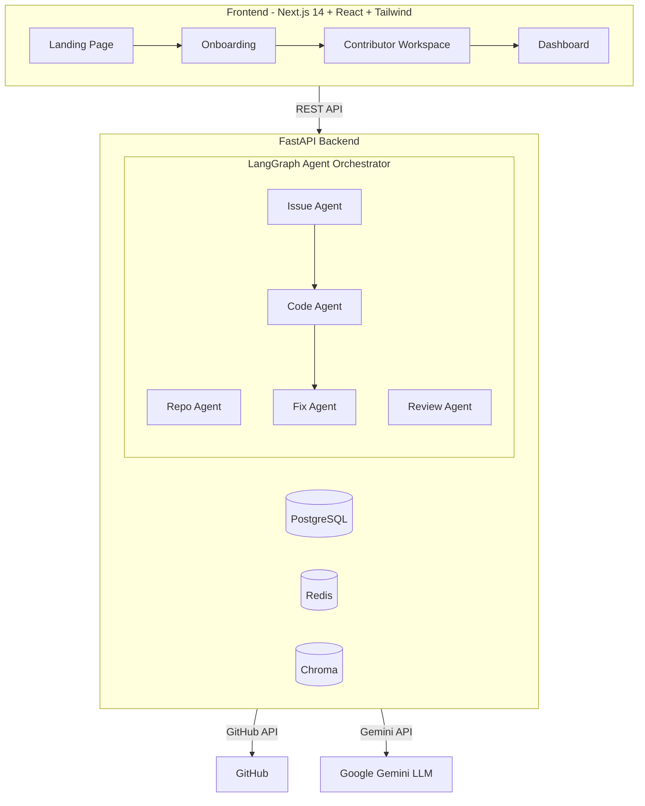
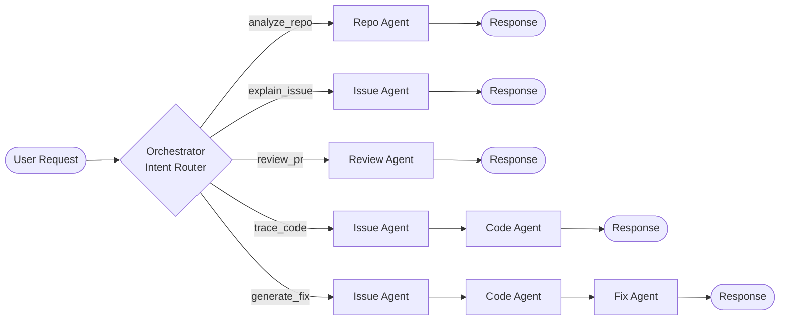

<p align="center">
  
</p>

<h1 align="center">Open Source Mentee Agent</h1>

<p align="center">
  <strong>An AI-powered multi-agent platform that turns overwhelmed newcomers into confident open-source contributors.</strong>
</p>

<p align="center">
  <em>Built with LangGraph · Google Gemini · FastAPI · Next.js</em>
</p>

---

## 📌 Table of Contents

- [The Problem](#-the-problem)
- [Our Solution](#-our-solution)
- [Why Agents?](#-why-agents--innovation)
- [Architecture](#-architecture)
- [Agent Constellation](#-agent-constellation)
- [Tech Stack](#-tech-stack)
- [Demo & Screenshots](#-demo--screenshots)
- [Getting Started](#-getting-started)
- [Project Structure](#-project-structure)
- [Project Journey](#-project-journey)
- [Documentation](#-documentation)
- [License](#-license)

---

## 🔥 The Problem

Open source is the backbone of modern software — yet **the entry barrier for new contributors is unreasonably high.**

Every year, events like **Google Summer of Code (GSoC)** and **Hacktoberfest** attract hundreds of thousands of eager developers. But the reality they face is brutal:

| Pain Point | Impact |
|---|---|
| **Codebase overwhelm** | Large, unfamiliar repos with thousands of files and zero onboarding docs |
| **Opaque issues** | GitHub issues written for seasoned maintainers — jargon-heavy, context-poor |
| **File-level guesswork** | No idea *which files* to touch or *how they connect* |
| **Blind coding** | No step-by-step guidance; contributors code in the dark |
| **PR rejection loop** | Submissions rejected for avoidable bugs, style violations, and missing tests |

> **The result?** Over **60% of first-time contributors never submit a second PR.** The open-source community loses thousands of potential contributors to friction that AI can eliminate.

---

## 💡 Our Solution

**Open Source Mentee Agent** is a multi-agent AI platform that acts as a **personal open-source mentor** — guiding contributors from "I found a repo" to "My PR got merged," step by step.

Instead of a single monolithic AI, we deploy a **constellation of 6 specialized AI agents**, each an expert in one phase of the contribution workflow. A central **Orchestrator Agent** powered by LangGraph dynamically routes requests through the right agent pipeline — just like a senior developer would delegate tasks across their team.

### What It Does (End to End)

```
1. ORIENT  →  Paste a repo URL → Get an instant tech stack & directory orientation
2. UNDERSTAND  →  Paste an issue URL → Get a plain-English summary with difficulty rating
3. DISCOVER  →  AI identifies the exact files you need to modify + call graph
4. PLAN  →  Get a numbered, step-by-step implementation plan with code snippets
5. REVIEW  →  Paste your PR link → Catch bugs, security issues & style violations before submitting
```

> **No GitHub OAuth required.** Enter your GitHub username and start contributing — your real profile, repos, and stats power a personalized, gamified dashboard.

---

## 🤖 Why Agents? — Innovation

This project is not a wrapper around a single LLM prompt. **Agents are the core architecture** — not an afterthought.

### The Multi-Agent Advantage

A single LLM call cannot reliably orient a codebase, simplify an issue, trace affected files, generate a fix plan, AND review a PR. Each task requires different context, different prompts, and different tools. Our agent architecture solves this through **specialization and orchestration:**

| Design Decision | Why It Matters |
|---|---|
| **Separation of concerns** | Each agent has a focused prompt, dedicated tools, and a constrained output schema — reducing hallucination and improving reliability |
| **Composable pipelines** | Agents chain dynamically: `IssueAgent → CodeAgent → FixAgent` passes enriched context downstream, each agent building on the previous one's output |
| **Shared state graph** | LangGraph maintains a typed state object (`AgentState`) that flows through the graph — agents read from and write to shared state without tight coupling |
| **Graceful degradation** | If one agent fails, the orchestrator returns a partial result — the user still gets value |
| **Independent scalability** | Each agent can be optimized, swapped, or upgraded independently without touching the others |

### How the Orchestrator Works

The Orchestrator Agent acts as a **LangGraph router**. It inspects the user's intent and dispatches to the correct sub-agent chain:

```
User Intent              Agent Pipeline
─────────────────────    ──────────────────────────────────
analyze_repo         →   RepoAgent
explain_issue        →   IssueAgent
trace_code           →   IssueAgent → CodeAgent
generate_fix         →   IssueAgent → CodeAgent → FixAgent
review_pr            →   ReviewAgent
```

This is not hardcoded `if/else` routing — it's a **compiled LangGraph StateGraph** with conditional edges that dynamically determine the next node based on shared state.

---

## 🏗️ Architecture

### High-Level System Architecture



### Agent Flow — The LangGraph State Machine



Each node in the graph is a **LangGraph node function** that receives and returns a typed `AgentState` dictionary. Conditional edges (`after_issue_agent`, `after_code_agent`) determine whether execution continues downstream or terminates.

---

## 🧠 Agent Constellation

| Agent | Purpose | Tools | Input → Output |
|---|---|---|---|
| **🎯 Orchestrator** | Routes requests to the right agent pipeline based on user intent | LangGraph StateGraph, conditional edges | `(intent, payload)` → dispatches to sub-agent |
| **📂 Repo Agent** | Analyzes a GitHub repo's structure, tech stack, and key directories | GitHub Tree API, file reader, LLM | `repo_url` → structured orientation summary |
| **📝 Issue Agent** | Rewrites GitHub issues in plain English with difficulty rating & time estimate | GitHub Issues API, LLM | `issue_url` → simplified summary + difficulty |
| **🔍 Code Agent** | Identifies affected files and traces the call graph for a given issue | GitHub Tree API, file content reader, LLM | `issue_summary` → affected files + dependency map |
| **🔧 Fix Agent** | Generates a numbered step-by-step implementation plan with code snippets | LLM with full code context | `(issue + files + graph)` → fix plan with snippets |
| **🔎 Review Agent** | Reviews PR diffs for bugs, security issues, style violations, and missing tests | GitHub PR API, diff parser, LLM | `pr_url` → categorized feedback (Bug/Security/Style/Tests) |

### How Agents Compose

The agents are not isolated tools — they **compose into intelligent pipelines**:

```python
# When a user wants a full fix plan, 3 agents chain automatically:
#
# IssueAgent  →  understands the issue
#     ↓
# CodeAgent   →  finds affected files using issue context
#     ↓
# FixAgent    →  generates implementation plan using code context
#
# Each agent enriches the shared AgentState, and the next agent
# reads from it — zero manual wiring required.
```

---

## 🛠️ Tech Stack

### Backend
| Component | Technology | Purpose |
|---|---|---|
| API Framework | **FastAPI** (Python) | Async REST API with auto-generated OpenAPI docs |
| Agent Orchestration | **LangGraph** | Stateful multi-agent graph execution with conditional routing |
| LLM Chains | **LangChain** | Prompt templates, tool wrappers, output parsers |
| LLM Engine | **Google Gemini** | Reasoning, code analysis, summarization |
| Embeddings | **Gemini text-embedding-004** | Issue similarity vectors for duplicate detection |
| Database | **PostgreSQL 16** | Repositories, issues, contributors, sessions |
| Cache | **Redis 7** | Session state, API response cache, rate-limit counters |
| Vector Store | **Chroma** | Semantic similarity search |

### Frontend
| Component | Technology | Purpose |
|---|---|---|
| Framework | **Next.js 14** (App Router) | SSR + client-side rendering |
| UI Library | **React 18** | Component architecture |
| Styling | **Tailwind CSS** | Utility-first responsive design |
| Animations | **Framer Motion** | Micro-interactions and page transitions |
| Charts | **Recharts** | Dashboard data visualizations |
| Icons | **Lucide React** | Consistent icon system |

### Infrastructure
| Component | Technology | Purpose |
|---|---|---|
| Containerization | **Docker Compose** | One-command full-stack deployment |
| GitHub Integration | **PyGithub** | Repo tree, issues, PRs, user profiles |

---

## 🖼️ Demo & Screenshots

### User Flow

```
Landing Page
    └── "Start Contributing" / "Explore a Repo"
            └── /onboarding  ← Enter GitHub username
                    └── GitHub profile validated & avatar preview shown
                            └── /contributor/issues  ← Contributor workspace
                                    ├── Repo Orientation
                                    ├── Issue Helper (simplify + trace + fix)
                                    └── PR Review
```

### Key Screens

- **🏠 Landing Page** — Hero section with animated call-to-action
- **👤 Onboarding** — GitHub username entry with real-time profile validation and avatar preview
- **📊 Dashboard** — Gamified contributor profile with XP level, class badge, skill tracker, and top repos chart
- **🧭 Repo Orientation** — Paste a repo URL, get an instant tech stack and directory breakdown
- **📋 Issue Helper** — Paste an issue URL, get a plain-English summary, difficulty rating, affected files, and a step-by-step fix plan
- **🔍 PR Review** — Paste a PR URL, get categorized feedback on bugs, security, style, and test coverage

---

## 🚀 Getting Started

### Prerequisites

| Requirement | Version |
|---|---|
| Node.js | 18+ |
| Python | 3.11+ |
| Docker & Docker Compose | Latest (optional, for one-command setup) |
| Google Gemini API Key | [Get one here](https://aistudio.google.com/apikey) |
| GitHub Personal Access Token | [Create one here](https://github.com/settings/tokens) |

---

### Option 1: Docker Compose (Recommended)

The fastest way to get the full stack running:

```bash
# 1. Clone the repository
git clone https://github.com/SSbhadoria21/Open-Source-Agent.git
cd Open-Source-Agent

# 2. Configure environment variables
cp backend/.env.example backend/.env
# Edit backend/.env and fill in:
#   - GEMINI_API_KEY=your_gemini_api_key
#   - GITHUB_TOKENS=ghp_your_token

# 3. Launch everything
docker-compose up --build
```

- **Frontend:** [http://localhost:3000](http://localhost:3000)
- **Backend API:** [http://localhost:8000/docs](http://localhost:8000/docs) (Swagger UI)

---

### Option 2: Manual Setup

#### Backend

```bash
cd backend

# Create and activate a virtual environment
python -m venv venv
# Windows:
venv\Scripts\activate
# macOS/Linux:
source venv/bin/activate

# Install dependencies
pip install -r requirements.txt

# Configure environment
cp .env.example .env
# Edit .env — set GEMINI_API_KEY and GITHUB_TOKENS

# Start the server
uvicorn app.main:app --reload --port 8000
```

#### Frontend

```bash
cd frontend

# Install dependencies
npm install

# Start the dev server
npm run dev
```

Open [http://localhost:3000](http://localhost:3000) and click **Start Contributing** to begin.

---

## 📁 Project Structure

```
Open-Source-Agent/
│
├── backend/                        # FastAPI + LangGraph backend
│   ├── app/
│   │   ├── agents/                 # 🤖 All AI agents live here
│   │   │   ├── orchestrator.py     #    LangGraph state machine & router
│   │   │   ├── repo_agent.py       #    Repository orientation
│   │   │   ├── issue_agent.py      #    Issue simplification
│   │   │   ├── code_agent.py       #    File & flow discovery
│   │   │   ├── fix_agent.py        #    Implementation plan generation
│   │   │   ├── review_agent.py     #    PR review & feedback
│   │   │   ├── triage_agent.py     #    Issue triage (admin)
│   │   │   ├── duplicate_agent.py  #    Duplicate detection via Chroma
│   │   │   ├── label_agent.py      #    Auto-labeling
│   │   │   ├── match_agent.py      #    Contributor matching
│   │   │   └── health_agent.py     #    Project health metrics
│   │   ├── api/                    # REST API route handlers
│   │   ├── core/                   # Config, settings, utilities
│   │   ├── db/                     # Database connection & session
│   │   ├── models/                 # SQLAlchemy ORM models
│   │   ├── services/               # Business logic layer
│   │   └── main.py                 # FastAPI app entry point
│   ├── alembic/                    # Database migrations
│   ├── requirements.txt
│   └── .env.example
│
├── frontend/                       # Next.js 14 frontend
│   └── src/app/
│       ├── page.tsx                # Landing page
│       ├── onboarding/             # GitHub username entry
│       ├── dashboard/              # Gamified contributor profile
│       ├── contributor/            # Contributor workspace
│       │   ├── issues/             # Issue list & workspace home
│       │   ├── orientation/        # Repo orientation UI
│       │   ├── issue-helper/       # Issue simplify + trace + fix
│       │   └── pr-review/          # PR review UI
│       └── agent-graph/            # Agent visualization
│
├── docker-compose.yml              # One-command full-stack deployment
├── PRD_Open_Source_Mentee_Agent.md  # Product Requirements Document
├── TRD_Open_Source_Mentee_Agent.md  # Technical Requirements Document
└── README.md                       # ← You are here
```

---

## 🛤️ Project Journey

### The Spark

The idea was born from a frustration shared by every new open-source contributor: **"I want to contribute, but I don't know where to start."** Existing tools (GitHub's issue search, `good-first-issue` tags) help find *what* to work on — but they don't help you *understand the codebase*, *find the right files*, or *write quality code*. We realized that what newcomers need isn't a search engine — it's a **mentor**.

### Why Multi-Agent (Not a Single Prompt)

Our first prototype was a single LLM endpoint. It worked — barely. The context window got flooded, the outputs were inconsistent, and adding new capabilities (like PR review) meant rewriting the entire prompt. We pivoted to a **multi-agent architecture** where each agent is a specialist:

- The **Repo Agent** only cares about file trees and tech stacks.
- The **Issue Agent** only cares about issue comprehension.
- The **Code Agent** only cares about tracing file dependencies.
- They **compose dynamically** through LangGraph's state machine.

This separation of concerns made the system dramatically more reliable and maintainable.

### Key Milestones

| Milestone | Description | Status |
|---|---|---|
| **M1** | GitHub username onboarding + personalized gamified dashboard | ✅ Complete |
| **M2** | Core contributor flow — Repo + Issue + Code Agent integration | ✅ Complete |
| **M3** | Fix Agent + Review Agent — full contribution pipeline | ✅ Complete |
| **M4** | Frontend ↔ Backend integration — real API calls replacing dummy data | ✅ Complete |
| **M5** | Docker Compose deployment + polish | ✅ Complete |

### Challenges & Learnings

- **LLM Rate Limits:** Free-tier Gemini API has aggressive rate limits. We implemented exponential backoff retry logic and model fallback (`gemini-2.0-flash` → `gemini-1.5-flash`) to ensure uninterrupted operation.
- **Agent State Management:** Passing rich context between agents (e.g., Code Agent passing real file contents to Fix Agent) required careful state schema design in LangGraph's `TypedDict`.
- **Frontend-Backend Integration:** Moving from dummy data to real API calls surfaced subtle issues in error handling, loading states, and data shape mismatches — all resolved through a centralized API service layer.

---

## 📜 Documentation

| Document | Description |
|---|---|
| [Product Requirements Document (PRD)](./PRD_Open_Source_Mentee_Agent.md) | User personas, feature specs, success metrics, and acceptance criteria |
| [Technical Requirements Document (TRD)](./TRD_Open_Source_Mentee_Agent.md) | System architecture, agent specs, data models, API definitions, and infrastructure |

---

## 📄 License

This project is open source and available under the [MIT License](./LICENSE).

---

<p align="center">
  <strong>Built with ❤️ for the open-source community</strong>
  <br/>
  <em>Because every contributor deserves a mentor.</em>
</p>